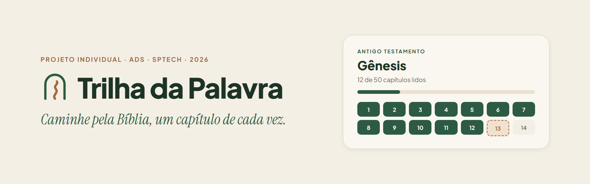
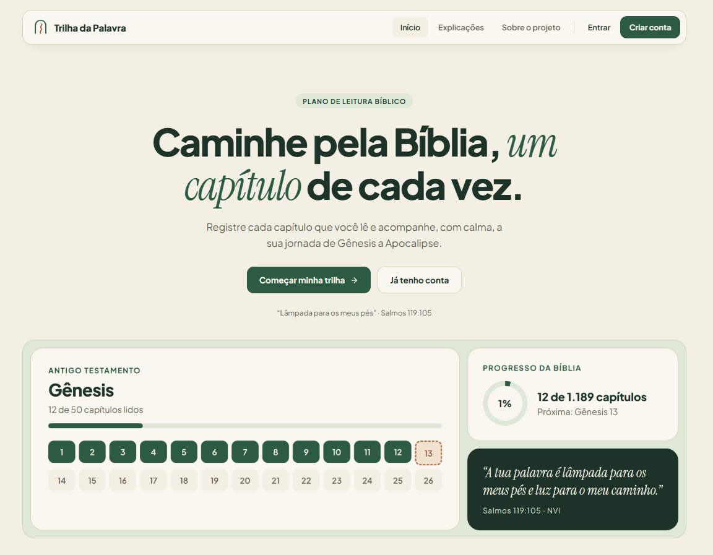
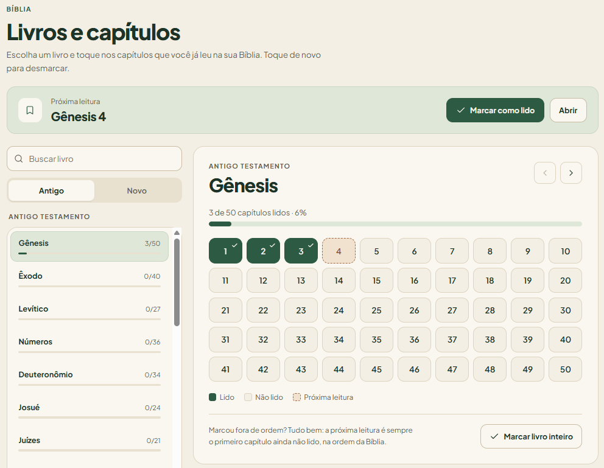
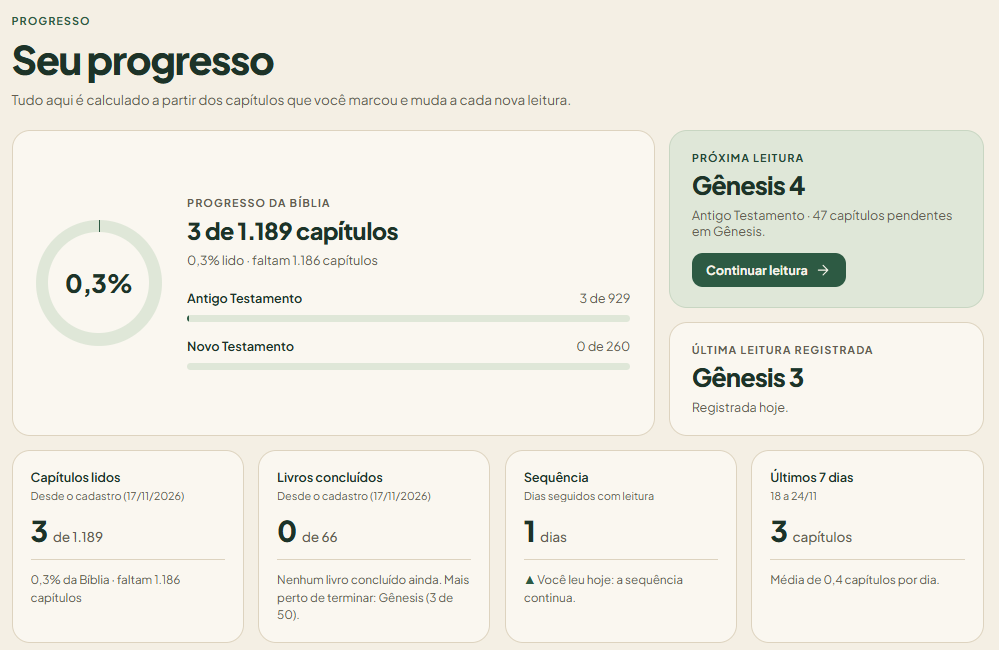
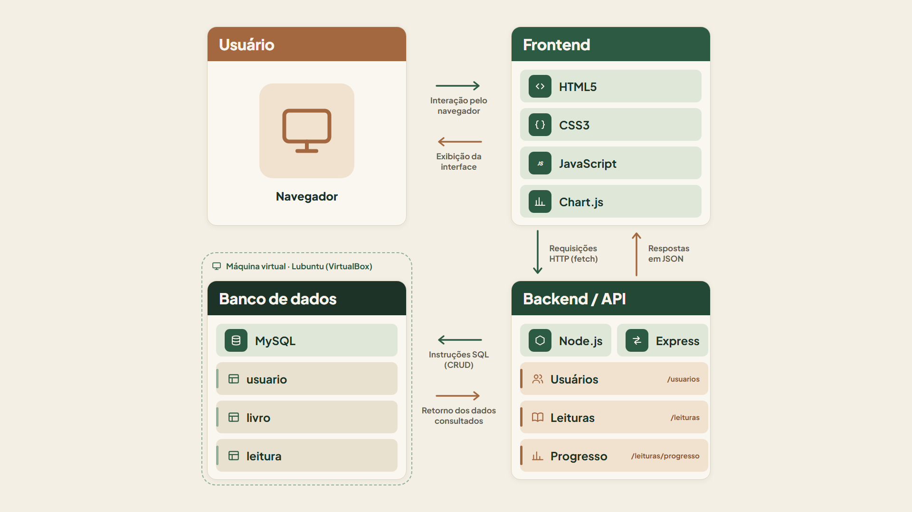

<p align="center">
  
</p>

<p align="center">
  
  
  
  
  
  
  
</p>

### Caminhe pela Bíblia, um capítulo de cada vez.

O Trilha da Palavra é o meu projeto individual da disciplina de Pesquisa e Inovação, desenvolvido no 1º semestre de Análise e Desenvolvimento de Sistemas da São Paulo Tech School.

A base do projeto é o Web Data Viz, disponibilizado pela faculdade. Sobre essa estrutura, construí as páginas, a API e o banco de dados do Trilha com o que aprendi nas aulas.

## Sobre o projeto

O Trilha da Palavra é um website de acompanhamento da leitura bíblica, pensado para quem está começando. A pessoa cria uma conta, marca os capítulos que já leu e acompanha a própria evolução em uma dashboard, de Gênesis a Apocalipse.

A ideia nasceu da minha fé. Acredito que a Palavra de Deus não deve parar em mim, e este projeto foi a forma que encontrei de unir isso ao que estou aprendendo no curso.

O problema que o site busca resolver é a falta de constância. A Bíblia tem 1.189 capítulos e, sem enxergar o próprio avanço, é fácil perder a sequência e desistir no meio do caminho. Por isso, o objetivo do Trilha é tornar o progresso visível a cada capítulo lido e ajudar o leitor a transformar a leitura em hábito.

## Objetivos de Desenvolvimento Sustentável

O projeto se relaciona com dois ODS da Agenda 2030 da ONU:

- **ODS 4 – Educação de Qualidade:** incentiva a leitura frequente e organizada de um livro extenso, contribuindo para o hábito de leitura.
- **ODS 3 – Saúde e Bem-Estar:** estimula um momento diário de leitura e reflexão, ligado ao cuidado com a saúde emocional e espiritual.

## Funcionalidades

**Conta**
- Cadastro com validação dos campos e regras de senha conferidas no navegador e no servidor.
- Login com e-mail e senha.
- Perfil com nome, livro favorito, avatar inspirado em personagens bíblicos ou foto personalizada.
- Troca de senha.

**Bíblia**
- Os 66 livros separados em Antigo e Novo Testamento, com busca por livro.
- Marcação e desmarcação de capítulos, um por um ou o livro inteiro.
- Próxima leitura sempre indicada, com atalho para marcá-la como lida.

**Progresso (dashboard)**
- Percentual da Bíblia concluído e progresso no Antigo e no Novo Testamento.
- Indicadores de capítulos lidos, livros concluídos, sequência de dias e últimos 7 dias.
- Gráfico de capítulos lidos por dia e gráfico com a situação dos 66 livros.
- Média diária e previsão de dias para terminar a Bíblia.

**Site institucional**
- Páginas Início, Sobre o projeto e Explicações.

O Trilha é um website acessado pelo navegador. Não fazem parte do projeto um aplicativo para celular, comentários ou grupos entre usuários e o envio de notificações.

## Telas

<p align="center">
  
  <br><sub>Página inicial</sub>
</p>

<p align="center">
  
  <br><sub>Página Bíblia: livros e capítulos</sub>
</p>

<p align="center">
  
  <br><sub>Página Progresso (dashboard)</sub>
</p>

## Tecnologias

| Camada | Tecnologia |
|---|---|
| Front-end | HTML, CSS e JavaScript |
| Gráficos | Chart.js, com o plugin datalabels |
| Back-end | Node.js com Express (rotas, controllers e models) |
| Banco de dados | MySQL, em uma máquina virtual Lubuntu no VirtualBox |
| Organização | Git, GitHub e Trello |

## Arquitetura

<p align="center">
  
</p>

O navegador envia as requisições com `fetch` para a API em Express. As rotas encaminham cada pedido ao controller, que valida os dados e chama o model, responsável pelas instruções SQL no MySQL. A resposta volta pelo mesmo caminho, em JSON.

### Banco de dados

| Tabela | O que guarda |
|---|---|
| `usuario` | os dados da conta: nome, e-mail, senha, avatar, foto, data de cadastro e livro favorito |
| `livro` | os 66 livros da Bíblia, com o testamento e a quantidade de capítulos |
| `leitura` | cada capítulo marcado por um usuário, com a data da leitura |

- Um usuário tem várias leituras, e um livro aparece em várias leituras (1:N).
- O livro favorito é opcional e liga o usuário a um livro.
- A mesma leitura não se repete: a combinação usuário + livro + capítulo é única.

## Como rodar localmente

**Pré-requisitos:** Node.js e MySQL instalados.

1. Clone o repositório e instale as dependências:

   ```bash
   git clone https://github.com/adrianpatricio/trilha_da_palavra.git
   cd trilha_da_palavra
   npm install
   ```

2. No MySQL, execute o script `src/database/script-tabelas.sql`. Ele cria o banco, as tabelas e os 66 livros.

3. Crie um arquivo `.env.dev` na raiz do projeto, com as suas próprias configurações:

   ```env
   AMBIENTE_PROCESSO=desenvolvimento
   APP_PORT=
   APP_HOST=
   DB_HOST=
   DB_DATABASE=trilha_da_palavra
   DB_USER=
   DB_PASSWORD=
   DB_PORT=
   ```

   O arquivo `.env.dev` não é enviado ao repositório.

4. Inicie o servidor:

   ```bash
   npm start
   ```

   Para reiniciar automaticamente a cada alteração, use `npm run dev`.

5. Abra no navegador o endereço exibido no terminal (`http://APP_HOST:APP_PORT`).

## Andamento

✅ Projeto concluído para a apresentação final, entre 26/11 e 04/12/2026.

## Organização e aprendizado

Organizei as tarefas no Trello, com um backlog priorizado em Excel e Google Sheets, e registrei a evolução do código no GitHub.

O apoio de inteligência artificial está registrado no Diário de Prompts, com o que pedi, o que usei e o que alterei durante o desenvolvimento.

As orientações do projeto estão no [AGENTS.md](AGENTS.md).

## Créditos

Base da aplicação: Web Data Viz, fornecido pela São Paulo Tech School como material de apoio.

Desenvolvimento do Trilha da Palavra: **Adrian Patrício da Silva**.

Licença: [MIT](LICENSE).
